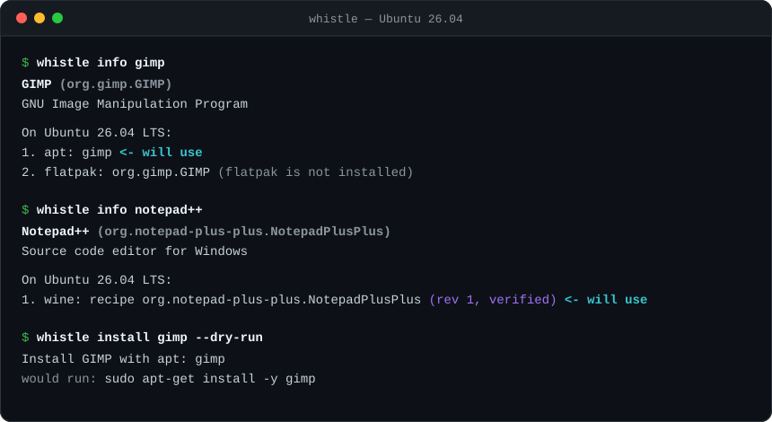
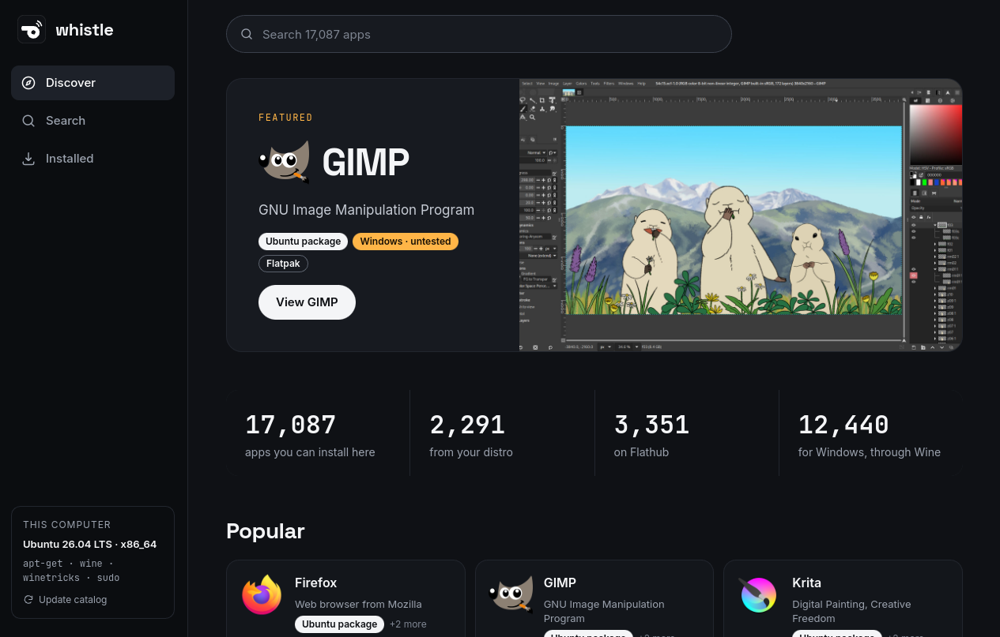
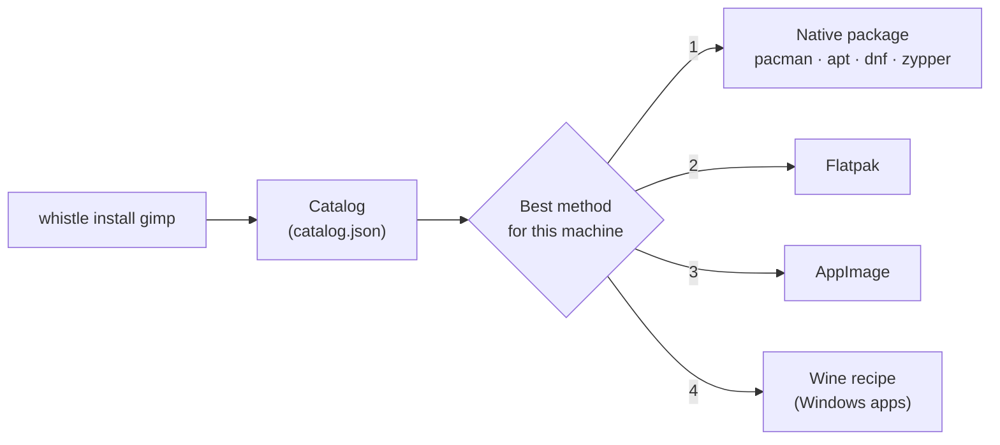

<p align="center">
  
</p>

<h1 align="center">Whistle</h1>

<p align="center">
  <b>One app store for every Linux distro, with your Windows apps included.</b><br>
  <code>whistle install gimp</code> picks the best way to get an app on your machine.
</p>

<p align="center">
  <a href="https://github.com/thisisroot/whistle/actions/workflows/ci.yml"></a>
  <a href="https://github.com/thisisroot/whistle-server/actions/workflows/publish-index.yml"></a>
  
  
  <a href="LICENSE"></a>
</p>

<p align="center">
  <a href="#quick-start">Quick start</a> ·
  <a href="#the-app-store-window">App</a> ·
  <a href="#commands">Commands</a> ·
  <a href="#how-it-works">How it works</a> ·
  <a href="#safety">Safety</a> ·
  <a href="#development">Development</a> ·
  <a href="#roadmap">Roadmap</a>
</p>

<p align="center">
  
</p>

## Why Whistle

Every distro has its own package manager, its own package names and its own
gaps. Windows-only apps add another layer: Wine prefixes, winetricks and
registry tweaks. Whistle gives you one command for all of it.

- **One name, every distro.** `whistle install firefox` becomes `pacman`, `apt`,
  `dnf` or `zypper` with that distro's package name, or Flatpak when the distro
  doesn't ship the app.
- **Windows apps, one command.** A recipe sets up a Wine prefix per app, runs
  the installer and adds the app to your menu, with its own icon.
- **Nothing hosted, nothing hidden.** Whistle drives the package managers you
  already have. Installers come from the vendor's own site and must match a
  pinned SHA-256.
- **Everything, in one search.** About 17,700 apps: all of Flathub, the desktop
  apps the distros ship themselves, and over 12,000 Windows apps from
  [winget](https://github.com/microsoft/winget-pkgs). Most Linux apps come with
  an icon and screenshots. Anything else your distro packages, like `htop` or
  `ffmpeg`, is found and installed through your own package manager.

## Supported systems

| Distro                 | Package manager | Tested in CI-style containers |
| ---------------------- | --------------- | :---------------------------: |
| Arch Linux             | pacman          | ✓ |
| Debian (stable)        | apt             | ✓ |
| Ubuntu (latest)        | apt             | ✓ |
| Fedora (latest)        | dnf             | ✓ |
| openSUSE Tumbleweed    | zypper          | ✓ |
| Any distro             | Flatpak (per-user), AppImage | |
| Linux with Wine        | Windows apps through recipes | Notepad++ verified on Wine 10 |

If an app needs Flatpak or Wine and it isn't installed, `whistle install`
offers to install it with your package manager first.

Distros based on these (Linux Mint, Pop!_OS, Manjaro, EndeavourOS and others)
work through `ID_LIKE` in `/etc/os-release`.

## Quick start

```sh
curl -fsSL https://raw.githubusercontent.com/thisisroot/whistle/main/install.sh | sh
```

This puts a single static binary in `~/.local/bin` (no root needed) and checks
it against the release's `SHA256SUMS`. It works on x86_64 and aarch64, on any
distro. Run it again to upgrade Whistle itself. Set `WHISTLE_VERSION=v0.1.0` to
pin a version, or `WHISTLE_INSTALL_DIR` to put it somewhere else.

Then:

```sh
whistle update            # download the latest catalog
whistle doctor            # what Whistle sees on this machine
whistle install gimp
```

### The app store window

<p align="center">
  
</p>

Prefer clicking to typing? Get the Whistle app from the
[latest release](https://github.com/thisisroot/whistle/releases/latest): the
`.deb` for Debian and Ubuntu, the `.rpm` for Fedora and openSUSE, or the
`.AppImage` for any distro. It shows the same catalog with icons and
screenshots, lets you pick how each app is installed, and keeps what you
installed up to date. Like the command, it only offers apps and install methods
that work on your computer; command-line packages such as `htop` stay with
`whistle install`. Search puts popular apps first: "code" finds Visual Studio
Code, "office" finds LibreOffice.

<details>
<summary>Other ways to install</summary>

**Download it yourself.** Get `whistle-<arch>-linux.tar.gz` from the
[latest release](https://github.com/thisisroot/whistle/releases/latest) and put
the `whistle` binary on your PATH. Every release is built by GitHub Actions with
[build provenance](https://docs.github.com/en/actions/security-for-github-actions/using-artifact-attestations),
which you can check with
`gh attestation verify whistle-x86_64-linux.tar.gz --repo thisisroot/whistle`.

**Build from source** with Rust 1.88 or newer:

```sh
git clone https://github.com/thisisroot/whistle.git
cd whistle
cargo build --release
install -Dm755 target/release/whistle ~/.local/bin/whistle
```

</details>

## Commands

| Command | What it does |
| --- | --- |
| `whistle search <text>` | Find apps by name, ID or description, plus your distro's other packages. |
| `whistle categories` | The app categories, and how many apps each has. |
| `whistle info <app>` | The app's details and screenshots, and every way to install it here, best first. |
| `whistle install <app>` | Install it with the best available method. |
| `whistle remove <app>` | Uninstall it the same way it was installed. |
| `whistle list` | Apps installed through Whistle. |
| `whistle upgrade [<app>...]` | Update the catalog, then upgrade what Whistle installed. |
| `whistle update [--from URL\|PATH]` | Download the latest catalog. |
| `whistle doctor` | Show the distro, platform tags, CPU and the tools found. |
| `whistle self-update` | Update Whistle itself to the latest release. |

`search` takes `--native`, `--flatpak` or `--windows` to show only apps
installed that way, and `--category <name>` (such as `Game` or `Graphics`).
`search`, `info`, `list` and `categories` print JSON with `--json`.

When a name matches several apps, `whistle` lists them and asks which one you
mean. An app that installs on Linux wins over a Windows-only app of the same
name.
Useful flags for `install`:

| Flag | Effect |
| --- | --- |
| `--dry-run` | Print the commands and change nothing. |
| `-y` | Don't ask for confirmation. |
| `--via <method>` | Force a method: `native`, `apt`, `pacman`, `dnf`, `zypper`, `flatpak`, `appimage`, `wine`, ... |
| `--allow-draft` | Allow recipes that nobody has reviewed yet. |

`upgrade` upgrades each app the way it was installed: one package-manager call
per manager, `flatpak update` for Flatpaks, and a fresh run of the recipe when
the catalog has a newer revision of it (the app keeps its settings). On Arch,
only whole-system upgrades are supported, so Whistle leaves native packages to
`sudo pacman -Syu`.

### Tab completion

Commands, flags and app names complete with Tab. Add one line to your shell's
startup file:

```sh
source <(COMPLETE=bash whistle)              # ~/.bashrc
source <(COMPLETE=zsh whistle)               # ~/.zshrc
COMPLETE=fish whistle | source               # ~/.config/fish/config.fish
```

### Windows apps

Windows apps come in two kinds:

- **Reviewed recipes** from [whistle-recipes](https://github.com/thisisroot/whistle-recipes),
  marked `verified` or `community`.
- **Generated recipes** for the rest of winget, marked `untested`. Whistle asks
  before using one, and after installing, starts the app once to check that it
  runs. If it closes right away, Whistle says so; `whistle remove` takes it away
  again.

Before installing, Whistle checks the recipe's minimum Wine version and free
disk space, and warns when the machine has less RAM than the app wants.

## How it works



1. **Catalog.** `whistle update` downloads the catalog (2.7 MB compressed),
   which [whistle-server](https://github.com/thisisroot/whistle-server) rebuilds
   and signs every day. For each app it lists the package name on each distro,
   the Flatpak ref, the winget ID, any recipes for running it on the other OS,
   and its icon and screenshots.
2. **Resolve.** Whistle reads `/etc/os-release` and checks which tools are
   installed. It ranks every option in this order: native package, Flatpak,
   AppImage, winget, vendor installer, Wine recipe, Proton, WSL, VM. An option
   that can't be used here is shown with the reason (`flatpak is not
   installed`). A package listed for your exact distro beats one listed for the
   distro it's based on.
3. **Install.** Package managers are called directly. A Wine recipe gets its
   own prefix in `~/.local/share/whistle/prefixes/<recipe>` and a menu entry per
   program, taken from the installer's Start Menu shortcuts. Wine's own menu
   builder only runs into a staging folder, so it leaves no stray menu entries
   or file associations behind. Afterwards, the prefix's copies of Wine's own DLLs are replaced with
   links to the read-only originals, which keeps a prefix around 150 MB instead
   of 1.3 GB. When the system's Wine is upgraded, the links already point to the
   new DLLs.
4. **Track.** Installed apps are recorded in
   `~/.local/share/whistle/installed.json`, so `whistle remove` undoes exactly
   what `install` did.

## Safety

- **Signed catalog.** Whistle only accepts a downloaded catalog that is signed
  with the key built into it ([minisign](https://jedisct1.github.io/minisign/)),
  and refuses one older than the catalog it already has.
- **No shell.** Every command runs as a plain argument list. Package names are
  validated before they reach a package manager.
- **Verified downloads.** HTTPS only. Installers are checked against a pinned
  SHA-256 before they run, and a mismatch stops the install.
- **Sandboxed recipes.** Recipes can only use typed steps (winetricks, DLL
  overrides, registry, copy, environment, run installer). There is no "run this
  script" step. The client re-checks every path and registry key, so a bad
  catalog can't make a recipe write outside its prefix.
- **Honest about untested apps.** Generated recipes are marked `untested`,
  checked after install, and never preferred over a reviewed recipe. Draft
  recipes are only offered with `--allow-draft`.
- **Asks first.** Nothing changes until you confirm, and `--dry-run` shows the
  exact commands.

## Configuration

| Variable | Effect |
| --- | --- |
| `WHISTLE_INDEX_URL` | Where `whistle update` downloads the catalog from. |
| `WHISTLE_INDEX_PUBKEY` | The minisign public key that catalog is signed with, if it's not the official one. |
| `WHISTLE_INDEX` | Use this index file instead of the downloaded one. |
| `WHISTLE_ROOT` | Keep all of Whistle's files under this folder (handy for testing). |
| `WHISTLE_NO_IMAGES` | Don't show icons in terminals that can display images. |

Before the first `whistle update`, Whistle uses a small built-in catalog
([`catalog/dev-index.json`](catalog/dev-index.json)).

## Development

```sh
cargo test                              # unit tests
cargo clippy --all-targets -- -D warnings
tests/distros/run.sh path/to/index.json # real distros, needs Docker
```

The app store window is a [Tauri](https://tauri.app) app with a Svelte
frontend. It needs Node 22 and WebKitGTK (`libwebkit2gtk-4.1-dev`,
`libayatana-appindicator3-dev` and `librsvg2-dev` on Debian and Ubuntu), so a
plain `cargo build` leaves it out:

```sh
cd crates/whistle-gui
npm --prefix ui ci
npx --prefix ui tauri dev               # run it, reloading on changes
npx --prefix ui tauri build             # .deb, .rpm and .AppImage
```

`tests/distros/run.sh` runs Whistle inside Arch, Debian, Ubuntu, Fedora and
openSUSE containers. It checks that every package the catalog lists for that
distro exists, then installs and removes one app for real. The recipe test reads
a [whistle-recipes](https://github.com/thisisroot/whistle-recipes) checkout next
to this one, or the folder in `WHISTLE_RECIPES_DIR`.

| Path | Contents |
| --- | --- |
| [`crates/whistle-core`](crates/whistle-core) | Catalog, host detection, resolver, installers. Shared by the CLI and the app store window. |
| [`crates/whistle-cli`](crates/whistle-cli) | The `whistle` command. |
| [`crates/whistle-gui`](crates/whistle-gui) | The app store window: Rust commands in `src/`, the Svelte frontend in `ui/`. |
| [`catalog/dev-index.json`](catalog/dev-index.json) | The built-in catalog. |
| [`tests/distros`](tests/distros) | Real-distro container tests. |
| [`install.sh`](install.sh) | The one-line installer. |
| [`.github/workflows`](.github/workflows) | CI, and the release build of the command and the app (push a `v*` tag matching `Cargo.toml`). |

### The Whistle project

| Repo | Role |
| --- | --- |
| **whistle** (this repo) | The clients: the `whistle` command and the app store window. |
| [whistle-server](https://github.com/thisisroot/whistle-server) | Builds and publishes the catalog. |
| [whistle-recipes](https://github.com/thisisroot/whistle-recipes) | Recipes for running apps on the other OS. |

## Roadmap

- [x] CLI: search, info, install, remove, list, update, doctor
- [x] Native packages on Arch, Debian, Ubuntu, Fedora and openSUSE, plus Flatpak
- [x] Windows apps through Wine recipes
- [x] Published catalog of about 1,000 apps, rebuilt daily
- [x] Prebuilt binaries and a one-line installer
- [x] `whistle upgrade`, and Flatpak setup when it's missing
- [x] Signed catalog
- [x] All Flathub and distro apps, every distro package, 12,000 Windows apps from winget
- [x] Icons and screenshots
- [x] App store window
- [ ] Whistle on Windows
- [ ] Linux apps on Windows through WSL
- [ ] Automatic testing of generated Windows recipes in a sandbox
- [ ] Reporting whether an app works back to the catalog

## License

[GPL-3.0-or-later](LICENSE). You can use, study, change and share Whistle; if you distribute a
modified version, its source must be available under the same license.
