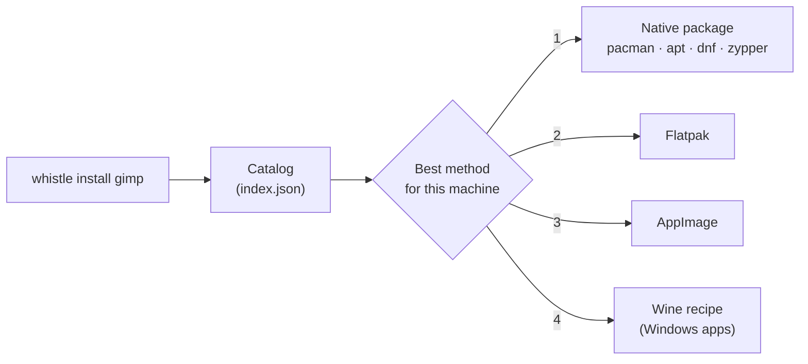

<p align="center">
  
</p>

<h1 align="center">Whistle</h1>

<p align="center">
  <b>One app store for every Linux distro, with your Windows apps included.</b><br>
  <code>whistle install gimp</code> picks the best way to get an app on your machine.
</p>

<p align="center">
  <a href="https://github.com/thisisroot/whistle/actions/workflows/ci.yml"></a>
  <a href="https://github.com/thisisroot/whistle-server/actions/workflows/publish-index.yml"></a>
  
  
  <a href="LICENSE"></a>
</p>

<p align="center">
  <a href="#quick-start">Quick start</a> ·
  <a href="#commands">Commands</a> ·
  <a href="#how-it-works">How it works</a> ·
  <a href="#safety">Safety</a> ·
  <a href="#development">Development</a> ·
  <a href="#roadmap">Roadmap</a>
</p>

<p align="center">
  
</p>

## Why Whistle

Every distro has its own package manager, its own package names and its own
gaps. Windows-only apps add another layer: Wine prefixes, winetricks and
registry tweaks. Whistle gives you one command for all of it.

- **One name, every distro.** `whistle install firefox` becomes `pacman`, `apt`,
  `dnf` or `zypper` with that distro's package name, or Flatpak when the distro
  doesn't ship the app.
- **Windows apps, one command.** Reviewed recipes set up a Wine prefix per app,
  run the installer and add the app to your menu.
- **Nothing hosted, nothing hidden.** Whistle drives the package managers you
  already have. Installers come from the vendor's own site and must match a
  pinned SHA-256.
- **About 1,000 apps** from Flathub and hand-maintained entries. Around 380 of
  them install as your distro's own package, matched through the distros'
  AppStream data.

## Supported systems

| Distro                 | Package manager | Tested in CI-style containers |
| ---------------------- | --------------- | :---------------------------: |
| Arch Linux             | pacman          | ✓ |
| Debian (stable)        | apt             | ✓ |
| Ubuntu (latest)        | apt             | ✓ |
| Fedora (latest)        | dnf             | ✓ |
| openSUSE Tumbleweed    | zypper          | ✓ |
| Any distro             | Flatpak (per-user), AppImage | |
| Linux with Wine        | Windows apps through recipes | Notepad++ verified on Wine 10 |

Distros based on these (Linux Mint, Pop!_OS, Manjaro, EndeavourOS and others)
work through `ID_LIKE` in `/etc/os-release`.

## Quick start

Prebuilt binaries are coming soon. For now, build from source with Rust 1.88 or newer:

```sh
git clone https://github.com/thisisroot/whistle.git
cd whistle
cargo build --release
sudo install target/release/whistle /usr/local/bin/   # or copy it anywhere on your PATH
```

Then:

```sh
whistle update            # download the latest catalog
whistle doctor            # what Whistle sees on this machine
whistle install gimp
```

## Commands

| Command | What it does |
| --- | --- |
| `whistle search <text>` | Find apps by name, ID or description. |
| `whistle info <app>` | Every way to install the app here, best first, and why the others don't apply. |
| `whistle install <app>` | Install it with the best available method. |
| `whistle remove <app>` | Uninstall it the same way it was installed. |
| `whistle list` | Apps installed through Whistle. |
| `whistle update [--from URL\|PATH]` | Download the latest catalog. |
| `whistle doctor` | Show the distro, platform tags, CPU and the tools found. |

Useful flags for `install`:

| Flag | Effect |
| --- | --- |
| `--dry-run` | Print the commands and change nothing. |
| `-y` | Don't ask for confirmation. |
| `--via <method>` | Force a method: `native`, `apt`, `pacman`, `dnf`, `zypper`, `flatpak`, `appimage`, `wine`, ... |
| `--allow-draft` | Allow recipes that nobody has reviewed yet. |

## How it works



1. **Catalog.** `whistle update` downloads `index.json`, which
   [whistle-server](https://github.com/thisisroot/whistle-server) rebuilds every
   day. For each app it lists the package name on each distro, the Flatpak ref,
   the winget ID and any recipes for running it on the other OS.
2. **Resolve.** Whistle reads `/etc/os-release` and checks which tools are
   installed. It ranks every option in this order: native package, Flatpak,
   AppImage, winget, vendor installer, Wine recipe, Proton, WSL, VM. An option
   that can't be used here is shown with the reason (`flatpak is not
   installed`). A package listed for your exact distro beats one listed for the
   distro it's based on.
3. **Install.** Package managers are called directly. A Wine recipe gets its
   own prefix in `~/.local/share/whistle/prefixes/<recipe>` and a menu entry per
   program. Afterwards, the prefix's copies of Wine's own DLLs are replaced with
   links to the read-only originals, which keeps a prefix around 150 MB instead
   of 1.3 GB.
4. **Track.** Installed apps are recorded in
   `~/.local/share/whistle/installed.json`, so `whistle remove` undoes exactly
   what `install` did.

## Safety

- **No shell.** Every command runs as a plain argument list. Package names are
  validated before they reach a package manager.
- **Verified downloads.** HTTPS only. Installers are checked against a pinned
  SHA-256 before they run, and a mismatch stops the install.
- **Sandboxed recipes.** Recipes can only use typed steps (winetricks, DLL
  overrides, registry, copy, environment, run installer). There is no "run this
  script" step. The client re-checks every path and registry key, so a bad
  catalog can't make a recipe write outside its prefix.
- **Reviewed by default.** Draft recipes are only offered with `--allow-draft`.
- **Asks first.** Nothing changes until you confirm, and `--dry-run` shows the
  exact commands.

## Configuration

| Variable | Effect |
| --- | --- |
| `WHISTLE_INDEX_URL` | Where `whistle update` downloads the catalog from. |
| `WHISTLE_INDEX` | Use this index file instead of the downloaded one. |
| `WHISTLE_ROOT` | Keep all of Whistle's files under this folder (handy for testing). |

Before the first `whistle update`, Whistle uses a small built-in catalog
([`catalog/dev-index.json`](catalog/dev-index.json)).

## Development

```sh
cargo test                              # unit tests
cargo clippy --all-targets -- -D warnings
tests/distros/run.sh path/to/index.json # real distros, needs Docker
```

`tests/distros/run.sh` runs Whistle inside Arch, Debian, Ubuntu, Fedora and
openSUSE containers. It checks that every package the catalog lists for that
distro exists, then installs and removes one app for real. The recipe test reads
a [whistle-recipes](https://github.com/thisisroot/whistle-recipes) checkout next
to this one, or the folder in `WHISTLE_RECIPES_DIR`.

| Path | Contents |
| --- | --- |
| [`crates/whistle-core`](crates/whistle-core) | Catalog, host detection, resolver, installers. Shared by the CLI and the future desktop app. |
| [`crates/whistle-cli`](crates/whistle-cli) | The `whistle` command. |
| [`catalog/dev-index.json`](catalog/dev-index.json) | The built-in catalog. |
| [`tests/distros`](tests/distros) | Real-distro container tests. |

### The Whistle project

| Repo | Role |
| --- | --- |
| **whistle** (this repo) | The client: CLI now, desktop app later. |
| [whistle-server](https://github.com/thisisroot/whistle-server) | Builds and publishes the catalog. |
| [whistle-recipes](https://github.com/thisisroot/whistle-recipes) | Recipes for running apps on the other OS. |

## Roadmap

- [x] CLI: search, info, install, remove, list, update, doctor
- [x] Native packages on Arch, Debian, Ubuntu, Fedora and openSUSE, plus Flatpak
- [x] Windows apps through Wine recipes
- [x] Published catalog of about 1,000 apps, rebuilt daily
- [ ] Prebuilt binaries and a one-line installer
- [ ] `whistle upgrade`, and Flatpak setup when it's missing
- [ ] Signed catalog
- [ ] More verified Windows recipes
- [ ] Proton, WSL and VM runtimes
- [ ] Desktop app

## License

[GPL-3.0-or-later](LICENSE). You can use, study, change and share Whistle; if you distribute a
modified version, its source must be available under the same license.
